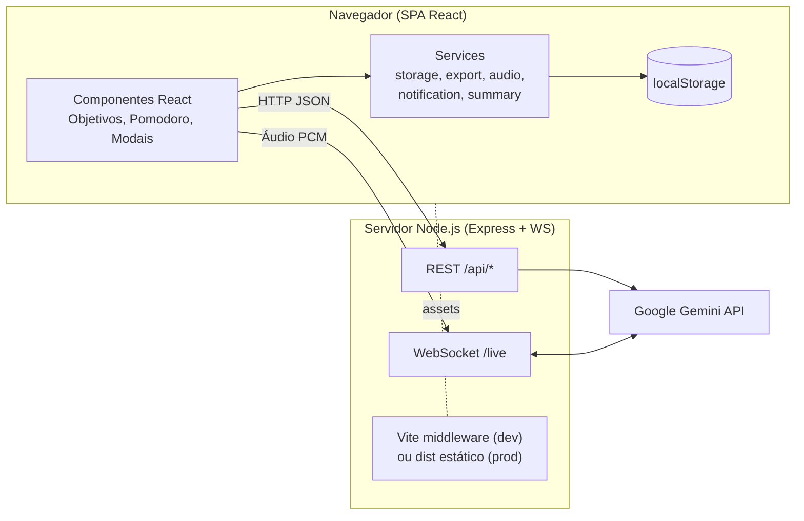

<div align="center">

# 📚 StudyRound

**Plataforma gamificada de estudos com foco Pomodoro, recompensas e mentoria por IA**

Organize objetivos de estudo, execute blocos de foco vinculados a cada meta, ganhe XP e conquistas, e conte com um tutor de IA por texto e por voz, tudo em um único fluxo.


</div>

---

## Sumário

- [Visão geral](#visão-geral)
- [O problema que o StudyRound resolve](#o-problema-que-o-studyround-resolve)
- [Funcionalidades](#funcionalidades)
- [Recursos de IA](#recursos-de-ia)
- [Regras de gamificação](#regras-de-gamificação)
- [Arquitetura](#arquitetura)
- [Stack tecnológica](#stack-tecnológica)
- [API do servidor](#api-do-servidor)
- [Modelo de dados](#modelo-de-dados)
- [Como executar localmente](#como-executar-localmente)
- [Scripts disponíveis](#scripts-disponíveis)
- [Estrutura de pastas](#estrutura-de-pastas)
- [Requisitos não funcionais](#requisitos-não-funcionais)
- [Roadmap](#roadmap)
- [Limitações conhecidas](#limitações-conhecidas)
- [Autor](#autor)

---

## Visão geral

O **StudyRound** é uma aplicação web voltada para estudantes iniciantes (vestibulandos, concurseiros, universitários e autodidatas em transição de carreira) que precisam transformar grandes conteúdos em metas diárias executáveis e manter constância.

O app une quatro etapas em um ciclo contínuo:

| Etapa | O que acontece |
| :--- | :--- |
| **Planejar** | Cadastro rápido de objetivos com categoria, prioridade, prazo e estimativa de Pomodoros |
| **Executar** | Cronômetro Pomodoro vinculado ao objetivo ativo, com modo Zen e som ambiente |
| **Recompensar** | XP, níveis, StudyCoins, sequência diária (streak) e medalhas a cada sessão concluída |
| **Analisar** | Painel de estatísticas e exportação de relatórios em CSV e PDF |

## O problema que o StudyRound resolve

1. **Paralisia por sobrecarga:** dificuldade em fatiar uma ementa grande em tarefas diárias claras.
2. **Procrastinação e dispersão:** falta de ritmo estruturado e excesso de multitarefa.
3. **Ausência de recompensa imediata:** estudar paga no longo prazo, e sem retorno de curto prazo a desistência nas primeiras semanas é alta.
4. **Ferramentas desconectadas:** planilha, cronômetro e bloco de notas separados geram troca de contexto constante.

O StudyRound centraliza planejamento, execução, recompensa e revisão em uma única interface.

---

## Funcionalidades

### 🎯 Gestão de objetivos
- CRUD completo: título, descrição, prazo, status (`A Fazer`, `Em Progresso`, `Concluído`), prioridade (`baixa`, `média`, `alta`) e categoria
- Categorias: Geral, Matemática, Linguagens, Ciências, Humanas, Programação, Concursos e Idiomas
- Estimativa de Pomodoros por objetivo com barra de progresso
- Busca por texto e filtros combinados por categoria e status
- Mudança automática de `A Fazer` para `Em Progresso` ao concluir o primeiro bloco de foco

### ⏱️ Cronômetro Pomodoro
- Três modos: **Foco Pleno** (25 min), **Pausa Curta** (5 min) e **Pausa Longa** (15 min)
- Vínculo direto com o objetivo ativo, acumulando minutos e ciclos no card correspondente
- **Modo Zen** em tela cheia para reduzir distrações
- Som ambiente gerado via Web Audio API (ruído filtrado estilo chuva) e efeitos sonoros de clique, alerta e conclusão
- Notificações do navegador ao final de cada ciclo
- Celebração visual com confete ao concluir sessões e objetivos

### 🏆 Gamificação
- XP, níveis, StudyCoins e sequência diária de estudo
- 6 medalhas desbloqueáveis (detalhes em [Regras de gamificação](#regras-de-gamificação))
- Painel de perfil com progresso de nível e coleção de conquistas

### 📂 Materiais e ferramentas de revisão
- Upload de materiais de estudo (`.pdf`, `.txt`, `.md`, `.doc`, `.docx`, `.png`, `.jpg`, `.json`) vinculados a objetivos
- Gerador de resumo estruturado (visão geral, pontos-chave, glossário de conceitos e conclusões)
- **Flashcards** gerados automaticamente, com marcação de cartões dominados
- **Quiz de fixação** com explicação da resposta correta
- Template de anotações no **Método Cornell**
- Biblioteca de resumos salvos

### 📊 Estatísticas e relatórios
- Tempo de foco por dia, totais de sessões e objetivos concluídos
- Exportação em **CSV** (padrão brasileiro, separador `;` e BOM UTF-8 para abrir direto no Excel)
- Relatório diagramado pronto para **impressão ou salvamento em PDF**

### 🎨 Experiência e interface
- Três temas: **Cozy Light**, **Warm Amber** e **Deep Dark**, com preferência persistida
- Layout responsivo para celular e desktop
- Animações de interface com Motion

---

## Recursos de IA

Toda chamada à IA passa pelo servidor Express. A chave da API **nunca é exposta ao navegador**.

| Recurso | Descrição | Modelo |
| :--- | :--- | :--- |
| **Dica do Dia** | Mentor pedagógico que analisa os objetivos em aberto, nível e streak do estudante e devolve dica prática, objetivo prioritário, técnica recomendada e frase motivacional em JSON estruturado. Possui *fallback* local caso a API falhe. | `gemini-3.8-flash` |
| **Mentor StudyRound (chat)** | Tutor por texto com contexto dos objetivos do aluno. Suporta **Google Search Grounding** opcional para informações atualizadas (editais, datas de provas, atualidades) com exibição das fontes. | `gemini-3.8-flash` |
| **Pesquisa acadêmica** | Consulta com busca no Google em tempo real e respostas objetivas em português. | `gemini-3.8-flash` |
| **Transcrição de áudio** | Grava pelo microfone ou recebe arquivo de áudio (aulas, anotações faladas) e transcreve com pontuação e parágrafos. | `gemini-3.5-transcribe` |
| **Tutor de Voz ao vivo** | Conversa por voz em tempo real via WebSocket (`/live`), com áudio PCM 16 kHz de entrada e 24 kHz de saída, suporte a interrupção e voz *Zephyr*. | `gemini-3.8-live` |

---

## Regras de gamificação

| Ação | XP | StudyCoins |
| :--- | ---: | ---: |
| Criar um objetivo | +20 | +5 |
| Cada minuto de foco concluído | +10 | +1 a cada 5 min |
| Concluir um objetivo | +100 | +25 |
| Subir de nível | | +20 (bônus) |

- **Progressão de nível:** o próximo nível exige `nível atual × 150` XP.
- **Streak:** incrementa quando há pelo menos uma sessão de foco em dias consecutivos e reinicia se houver um dia sem estudo.

| Medalha | Requisito |
| :--- | :--- |
| 🌱 Primeiro Passo | Criar 1 objetivo |
| ⏱️ Foco Inicial | Concluir 1 sessão de foco |
| 🔥 Constância de Ouro | Atingir 3 dias de streak |
| 📑 Mente Sintética | Gerar 1 resumo ou conjunto de flashcards |
| 🏆 Missão Cumprida | Concluir 1 objetivo |
| ☕ Estudo Aconchegante | Acumular 60 minutos de foco |

---

## Arquitetura



- **Um único processo** (`server.ts`) serve a API REST, o WebSocket de voz e o front-end (Vite em modo middleware no desenvolvimento, `dist/` em produção) na porta **3000**.
- **Persistência local-first:** objetivos, perfil, sessões, arquivos e resumos ficam no `localStorage` do navegador, com chaves versionadas (`studyround_*_v1`).
- **Camada de serviços** desacopla a lógica de negócio (recompensas, streak, exportação) dos componentes de interface.

---

## Stack tecnológica

**Front-end**
- React 19 + TypeScript
- Vite 8
- Tailwind CSS 4
- Motion (animações), Lucide React (ícones), canvas-confetti
- Web Audio API, Web Notifications API, MediaRecorder

**Back-end**
- Node.js + Express 4 (executado com `tsx`)
- WebSocket (`ws`) para streaming de áudio em tempo real
- SDK `@google/genai`
- dotenv

**Ferramentas**
- Bun (lockfile oficial do projeto) ou npm
- TypeScript compiler para checagem de tipos

---

## API do servidor

| Método | Rota | Corpo da requisição | Resposta |
| :--- | :--- | :--- | :--- |
| `POST` | `/api/study-tip` | `{ goals, studentName, level, streakDays }` | `{ tip, priorityGoalTitle, priorityReason, recommendedTechnique, inspirationalQuote }` |
| `POST` | `/api/chat` | `{ messages, useSearch, studentGoals }` | `{ text, groundingChunks, webSearchQueries }` |
| `POST` | `/api/search-grounding` | `{ query, topic? }` | `{ text, groundingChunks, webSearchQueries }` |
| `POST` | `/api/transcribe` | `{ audioData (base64), mimeType }` | `{ transcription }` |
| `WS` | `/live` | `{ audio }` (PCM 16 kHz em base64) | `{ audio }`, `{ interrupted }` ou `{ error }` |

Todas as rotas REST retornam `{ success: boolean, ... }`. O limite de corpo é de **50 MB** para suportar envio de áudio.

---

## Modelo de dados

Definido em [`src/types/study.ts`](src/types/study.ts).

| Entidade | Campos principais |
| :--- | :--- |
| `StudyGoal` | `title`, `description`, `deadline`, `status`, `priority`, `category`, `estimatedPomodoros`, `completedPomodoros`, `totalFocusMinutes`, `attachedFileIds` |
| `UserProfile` | `name`, `level`, `xp`, `studyCoins`, `streakDays`, `lastStudyDate`, `totalMinutesFocused`, `themePreference`, `unlockedBadgeIds` |
| `FocusSession` | `goalId`, `durationMinutes`, `mode` (`focus`, `short_break`, `long_break`), `completedAt` |
| `StudyFile` | `name`, `size`, `type`, `textContent`, `goalId`, `notes` |
| `StudySummary` | `overview`, `keyPoints`, `concepts`, `takeaways`, `flashcards`, `quiz` |
| `Badge` | `title`, `description`, `icon`, `requirement`, `unlocked` |

---

## Como executar localmente

### Pré-requisitos
- **Node.js 20+**
- **Bun** (recomendado) ou npm
- Uma chave da **Google Gemini API** ([Google AI Studio](https://aistudio.google.com/apikey))

### Passo a passo

```bash
# 1. Clone o repositório
git clone https://github.com/TrueBrick/StudyRound.git
cd StudyRound

# 2. Instale as dependências
bun install
# ou, com npm:
npm install

# 3. Configure as variáveis de ambiente
cp .env.example .env
# edite o .env e informe sua GEMINI_API_KEY

# 4. Inicie o servidor de desenvolvimento
bun run dev
# ou: npm run dev
```

Acesse **http://localhost:3000**.

> O navegador pedirá permissão para **microfone** (transcrição e tutor de voz) e **notificações** (fim dos ciclos Pomodoro).

### Variáveis de ambiente

| Variável | Obrigatória | Descrição |
| :--- | :---: | :--- |
| `GEMINI_API_KEY` | Sim | Chave da Google Gemini API, usada somente no servidor |
| `APP_URL` | Não | URL pública onde o app está hospedado |
| `NODE_ENV` | Não | Use `production` para servir o build da pasta `dist/` |

### Build de produção

```bash
bun run build
NODE_ENV=production bun run start
```

---

## Scripts disponíveis

| Script | Descrição |
| :--- | :--- |
| `dev` | Inicia Express + Vite em modo desenvolvimento com HMR |
| `start` | Inicia o servidor (use com `NODE_ENV=production` após o build) |
| `build` | Gera o bundle otimizado do front-end em `dist/` |
| `preview` | Pré-visualiza o build com o servidor do Vite (sem as rotas de API) |
| `lint` | Checagem de tipos com `tsc --noEmit` |
| `clean` | Remove `dist/` e artefatos de build |

---

## Estrutura de pastas

```
StudyRound/
├── server.ts                  # Express + WebSocket + integração Gemini
├── index.html                 # Ponto de entrada HTML e metatags
├── vite.config.ts             # Vite + React + Tailwind
├── metadata.json              # Metadados e permissões do app
├── .env.example               # Modelo de variáveis de ambiente
└── src/
    ├── main.tsx               # Bootstrap do React
    ├── App.tsx                # Layout principal, estado e orquestração dos modais
    ├── index.css              # Tailwind e temas
    ├── types/
    │   └── study.ts           # Tipos de domínio
    ├── services/
    │   ├── storageService.ts      # Persistência, recompensas, streak e medalhas
    │   ├── summaryService.ts      # Resumos, flashcards e quiz
    │   ├── exportService.ts       # Exportação CSV e PDF
    │   ├── audioService.ts        # Efeitos sonoros e som ambiente
    │   ├── notificationService.ts # Notificações do navegador
    │   └── geminiLiveService.ts   # Cliente de áudio do tutor de voz
    └── components/
        ├── Navbar.tsx
        ├── PomodoroTimer.tsx
        ├── GoalCard.tsx
        ├── GoalFormModal.tsx
        ├── DailyStudyTip.tsx
        ├── GamificationModal.tsx
        ├── StatsModal.tsx
        ├── StudyMaterialsModal.tsx
        ├── SummaryToolsModal.tsx
        ├── GeminiChatbotModal.tsx
        ├── AudioTranscriberModal.tsx
        ├── VoiceConversationModal.tsx
        └── EmptyState.tsx
```

---

## Requisitos não funcionais

| ID | Requisito | Meta |
| :--- | :--- | :--- |
| RNF-01 | Performance | First Contentful Paint < 1,2 s e resposta a cliques < 100 ms |
| RNF-02 | Precisão do cronômetro | Erro inferior a 0,1% mesmo com a aba em segundo plano |
| RNF-03 | Segurança | Chave de IA restrita ao servidor; criptografia no cliente para anotações (planejada) |
| RNF-04 | Disponibilidade | Funcionamento offline-first via PWA (planejado) |
| RNF-05 | Acessibilidade | WCAG 2.1 nível AA: contraste 4,5:1, navegação por teclado e rótulos ARIA |
| RNF-06 | Responsividade | De 320 px (smartphones) a 4K |

### Métricas de sucesso do produto

- **Ativação:** mais de 60% dos novos usuários concluem 1 Pomodoro nas primeiras 24 horas
- **Retenção D7:** acima de 35%
- **Foco semanal:** média de 5 horas ou mais por usuário ativo
- **Conversão de metas:** mais de 50% dos objetivos chegam a `Concluído`
- **Usabilidade (SUS):** pontuação de 82 ou mais com os primeiros 30 testadores

---

## Roadmap

**Fase 1: MVP (atual)**
- [x] CRUD de objetivos com filtros e busca
- [x] Pomodoro vinculado a objetivos, modo Zen e som ambiente
- [x] XP, níveis, StudyCoins, streak e medalhas
- [x] Materiais, resumos, flashcards, quiz e Método Cornell
- [x] Exportação CSV e PDF
- [x] Três temas visuais
- [x] Dica do dia, chat com Google Search, transcrição e tutor de voz com Gemini

**Fase 2: Confiabilidade e sincronização**
- [ ] Timer baseado em timestamp absoluto / Web Worker
- [ ] Migração de `localStorage` para IndexedDB
- [ ] PWA instalável com funcionamento offline e fila de sincronização
- [ ] Autenticação (e-mail/senha e Google) e sincronização entre dispositivos
- [ ] Criptografia de ponta a ponta (AES-GCM 256) para descrições e anotações
- [ ] Web Push com Service Worker para lembretes com a aba fechada
- [ ] Resumos e flashcards gerados por IA a partir do conteúdo real dos PDFs

**Fase 3: Engajamento**
- [ ] Visualização em Kanban
- [ ] Loja de avatares e cosméticos com StudyCoins
- [ ] Ranking entre amigos
- [ ] Subtarefas, tags e anexos por objetivo
- [ ] Relatório preditivo de conclusão da ementa
- [ ] Testes automatizados (unitários e E2E) e pipeline de CI

---

## Limitações conhecidas

- Os dados ficam apenas no navegador atual (`localStorage`); limpar os dados do site apaga o progresso.
- O cronômetro usa `setInterval` e pode atrasar quando a aba fica em segundo plano por muito tempo.
- A extração de texto funciona para `.txt`, `.md`, `.json` e `.csv`; PDFs e imagens são anexados, mas seu conteúdo ainda não é lido para gerar resumos.

---

## Autor

**Rodrigo Guimarães Oliveira**
Estudante de Engenharia de Software (FIAP) · Uberlândia, MG

[](https://github.com/TrueBrick)

---

<div align="center">

Feito com foco, um Pomodoro de cada vez. ⏱️

</div>
